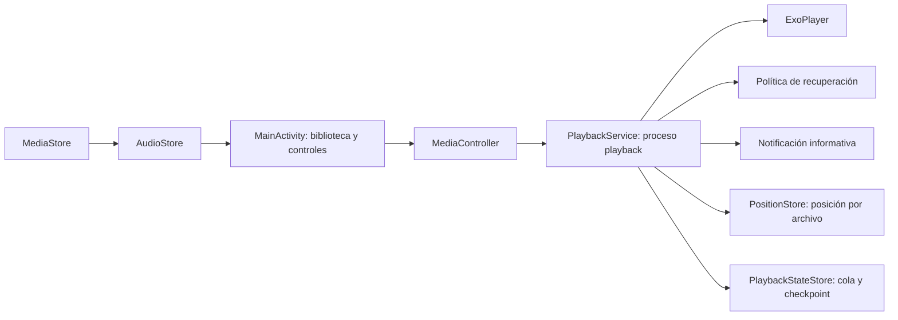

**Auditoría de Reproductor — 19 de septiembre de 2026**

Nota de publicación: este informe conserva sus conclusiones históricas. Las referencias de líneas corresponden a la versión revisada; los enlaces al código abren los archivos actuales.

> Informe histórico previo a las mejoras de la versión 1.2. Los cambios y pruebas
> posteriores se describen en [VALIDACION_CONTINUIDAD.md](VALIDACION_CONTINUIDAD.md).

El proyecto tiene una base adecuada para su propósito: reproducir un archivo local en bucle, mantener el motor separado de la pantalla y recuperar el estado tras determinados fallos. La versión revisada compila, supera Lint sin errores y pasa sus nueve pruebas. También conserva la posición y recupera el servicio en las pruebas realizadas en Android 15. Sus principales carencias actuales están en la sincronización de la biblioteca, accesibilidad, permisos y validación de las interacciones entre recuperación y persistencia.

No identifiqué un fallo P1 confirmado en esta revisión. Sí hay defectos P2 que conviene corregir antes de considerar madura la experiencia. Esto no certifica reproducción física ininterrumpida durante 24 horas, autonomía de batería ni comportamiento de todos los fabricantes.

Se revisaron los siete archivos Kotlin de producción, el test existente, manifiestos, recursos, configuración de compilación y documentación. La carpeta no contiene `.git`: no fue posible analizar historial ni cambios entre commits. No se modificó el código de la aplicación. Se creó este informe y evidencia de validación bajo `app/build/reports/audit-2026-09-19/`. La auditoría anterior, `ANALISIS_PROYECTO.md`, se conserva como documento histórico y no debe interpretarse como diagnóstico del código actual.

**1. Arquitectura y alcance real del producto**

Es una aplicación nativa con un módulo Android, Kotlin, vistas XML, ViewBinding, RecyclerView y Media3 ExoPlayer/Session. Hay 1.581 líneas Kotlin de producción y 125 líneas en un archivo de pruebas. Configura Android mínimo API 26, compilación y objetivo API 35, bytecode JVM 17, AGP 8.7.3, Kotlin 2.0.21 y Gradle 8.11.1. La compilación de esta auditoría se ejecutó con el JBR 21 instalado en el equipo.



La frontera entre procesos está bien elegida para el requisito de supervivencia del audio ante un fallo de la pantalla. La Activity manda órdenes; el servicio posee el reproductor y la persistencia. `PlaybackRecoveryPolicy` separa una regla pequeña que puede probarse sin Android. No hace falta una reescritura ni introducir múltiples módulos para resolver los defectos encontrados.

La repetición de una sola pista, la ausencia de controles externos y la falta de pausa automática al desconectar auriculares son decisiones explícitas del README. No se consideran defectos por sí mismas. Sí condicionan el producto: no es todavía un gestor completo de audiolibros con capítulos, velocidad, marcadores, búsqueda o temporizador. Incorporar esas funciones sería ampliar su alcance.

**2. Validación ejecutada**

Comando empleado:

```sh
ANDROID_HOME=/Users/gustavo/Library/Android/sdk ./gradlew assembleDebug lintDebug testDebugUnitTest --console=plain
```

Resultado: `BUILD SUCCESSFUL`, 52 tareas accionables, 50 ejecutadas y 2 recuperadas de caché. No había un directorio de compilación previo en esta copia al empezar. El APK debug generado ocupa aproximadamente 8,7 MiB.

| Verificación | Resultado y alcance |
| --- | --- |
| Compilación debug | Correcta. |
| Android Lint | 0 errores y 22 advertencias. |
| Pruebas unitarias | 9 ejecutadas, 0 fallos, 0 errores, 0 omitidas. Solo prueban `PlaybackRecoveryPolicy`. |
| Instalación y apertura | Correctas en emulador temporal API 35, ARM64. |
| Guardar y volver a una pista | Audit-A se guardó en 91.006 ms; tras seleccionar B y volver a A continuó desde ese marcador. La siguiente pausa quedó en 92.039 ms. |
| Reabrir después de una pausa | Conservó 92.039 ms, título y duración; abrió en pausa. |
| CPU en reposo y pausa | Los dos volcados de energía mostraron `Wake Locks: size=0`. No se midió consumo físico. |
| Desplazamiento con teclado | Fallo reproducido: cinco flechas derechas con el SeekBar enfocado dejaron el checkpoint y la posición visual en 93.863 ms. |
| Añadir audio a la biblioteca | Fallo reproducido: MediaStore tenía A/B/C, pero la pantalla mantuvo A/B incluso después de ir al inicio y volver. C apareció tras recrear la Activity. |
| Orden externa de pausa | `KEYCODE_MEDIA_PAUSE` no pausó: la posición avanzó de 94.696 a 98.706 ms y `desiredPlaying` siguió siendo verdadero. Es el comportamiento pretendido. |
| Terminar solo el proceso de UI | El servicio conservó su PID y la posición siguió avanzando, hasta 104.621 ms. |
| Terminar el proceso del servicio | Android creó un nuevo PID; el log confirmó recuperación tras reinicio. El checkpoint volvió a avanzar, conservando intención de reproducir. |
| Archivos eliminados | Se observaron errores de archivo no encontrado y selección de otras pistas. Al agotar las tres, el servicio programó la espera de 30.000 ms y la notificación mostró «Audio no disponible». La pausa desde la pantalla canceló la recuperación. No se esperó una ronda adicional completa. |
| Checkpoint corrupto | Se sustituyó el JSON reciente por contenido inválido en el emulador. Recuperó el checkpoint incrustado de la cola, en pausa, con título y duración. |

El emulador y sus datos se crearon para esta revisión. Se utilizaron WAV silenciosos de tres minutos y se deshabilitó la salida de audio del emulador. Por eso estas pruebas verifican estado, avance y ciclo de vida, no sonido audible. Se concedieron permisos y exención de batería en ese entorno: las pruebas de continuidad no demuestran comportamiento sin esa exención. No se utilizó un teléfono del usuario.

Evidencia: Lint HTML (referencia local histórica, no incluida), resultado JUnit (`app/build/test-results/testDebugUnitTest/TEST-com.reproductor.audiolibros.PlaybackRecoveryPolicyTest.xml`, referencia local histórica), pruebas básicas (`app/build/reports/audit-2026-09-19/runtime-log.txt`, referencia local histórica), interacciones (`app/build/reports/audit-2026-09-19/interaction-log.txt`, referencia local histórica), ciclo de vida (`app/build/reports/audit-2026-09-19/lifecycle-log.txt`, referencia local histórica), recuperación (`app/build/reports/audit-2026-09-19/recovery-log.txt`, referencia local histórica) y ronda de archivos ausentes (`app/build/reports/audit-2026-09-19/recovery-round-logcat.txt`, referencia local histórica). Los archivos bajo `build` son temporales y una limpieza de Gradle puede eliminarlos.

**3. Defectos prioritarios**

P2 significa un defecto funcional o de robustez relevante. P3 identifica mejoras de experiencia, rendimiento o mantenimiento. La certeza y el tipo de evidencia se indican por separado de la prioridad.

**A. [P2] La biblioteca no se actualiza durante la sesión. Reproducido.**

[MainActivity.kt:251](app/src/main/java/com/reproductor/audiolibros/MainActivity.kt) carga la biblioteca, pero los únicos disparadores están en `onCreate` y el resultado de permisos. [onResume:181](app/src/main/java/com/reproductor/audiolibros/MainActivity.kt) solo activa el temporizador de progreso. No existe observador ni acción de recarga.

Consecuencia: un audiolibro recién copiado parece no existir; uno eliminado sigue siendo seleccionable y puede iniciar una recuperación hacia otro archivo. La prueba añadió Audit-C y comprobó su presencia en MediaStore antes de volver a la app; solo apareció tras recrear la pantalla.

Corrección: actualizar al regresar cuando cambie la biblioteca, añadir recarga y/o observar MediaStore. Aplicar los resultados por identificador estable y preservar la selección. La consulta ya está fuera del hilo principal; no hace falta sustituir toda la arquitectura.

**B. [P2] El SeekBar no envía los desplazamientos de teclado o accesibilidad. Teclado reproducido; TalkBack sustentado por código.**

En [MainActivity.kt:313](app/src/main/java/com/reproductor/audiolibros/MainActivity.kt), `onProgressChanged(fromUser=true)` cambia el texto, pero `seekTo()` se ejecuta exclusivamente en `onStopTrackingTouch()`. Teclado y acciones de accesibilidad pueden cambiar el progreso sin finalizar un gesto táctil. El temporizador vuelve a mostrar la posición real, deshaciendo visualmente la acción. Ese comportamiento de los callbacks también está documentado en la [implementación AOSP de AbsSeekBar para Android 15](https://raw.githubusercontent.com/aosp-mirror/platform_frameworks_base/android-15.0.0_r1/core/java/android/widget/AbsSeekBar.java).

Corrección: aplicar los cambios originados por el usuario cuando no hay arrastre táctil en curso, manteniendo el envío final al terminar un arrastre. Añadir una prueba con teclado y una con acciones de accesibilidad.

**C. [P2] La recuperación de permisos es incompleta. Evidencia estática, confianza alta.**

[MainActivity.kt:224](app/src/main/java/com/reproductor/audiolibros/MainActivity.kt) siempre vuelve a solicitar permiso. No distingue una denegación permanente ni ofrece abrir Ajustes. Android puede dejar de mostrar el diálogo tras rechazos repetidos; el botón entonces parece no responder. [Referencia oficial sobre denegaciones](https://developer.android.com/training/permissions/requesting#handle-denial).

Además, si se concede acceso en Ajustes y se regresa a una Activity que sigue viva, el aviso anterior permanece: `onResume` no reevalúa el permiso ni recarga. Pulsar de nuevo el botón o recrear la pantalla permite recuperarse; no es un bloqueo irreversible.

Corrección: representar los estados de permiso explícitamente, ofrecer Ajustes cuando proceda y detectar cambios al regresar.

**D. [P2] Los errores de consulta pueden quedar sin explicación ni reintento. Evidencia estática, confianza alta.**

El `catch` de [MainActivity.kt:256](app/src/main/java/com/reproductor/audiolibros/MainActivity.kt) solo actualiza la pantalla si ya no hay permiso. Un fallo del proveedor con permiso concedido queda únicamente en Logcat. En la primera carga puede dejar una lista vacía con el panel de explicación oculto; tampoco hay recarga manual.

Corrección: distinguir carga, biblioteca vacía, error y permiso pendiente. Mostrar un mensaje de fallo con reintento. La captura de excepciones actual evita el cierre de la versión antigua, pero no resuelve la recuperación de la experiencia.

**E. [P2] Un reintento pendiente puede deshacer un desplazamiento manual. Evidencia estática; escenario específico sin reproducir.**

[PlaybackService.kt:349](app/src/main/java/com/reproductor/audiolibros/PlaybackService.kt) captura la posición al programar la recuperación; la línea 358 vuelve a ella al ejecutarse el temporizador. Los callbacks de interacción y discontinuidad guardan el progreso, pero no invalidan ni actualizan ese reintento.

Escenario necesario: la pista ya publicó un timeline desplazable, aparece un error transitorio, comienza una espera de cinco segundos y el usuario mueve la barra a otro minuto. El reintento puede volver a la posición anterior. Una pausa o la selección de otra fila sí cancela el trabajo pendiente. Borrar un archivo antes de prepararlo no reproduce este caso, porque normalmente deja la barra deshabilitada.

Corrección: cancelar o replanificar la recuperación cuando llega un seek del controlador, distinguiéndolo del seek interno del servicio. Probarlo con una fuente que falle después de preparar y un reloj controlado. No elevar este hallazgo a «observado en dispositivo» sin esa prueba.

**F. [P2] Una biblioteca que excede los límites de persistencia puede restaurar una sesión anterior. Evidencia estática, confianza alta.**

[MainActivity.kt:291](app/src/main/java/com/reproductor/audiolibros/MainActivity.kt) envía toda la biblioteca como cola. [PlaybackStateStore.kt:135](app/src/main/java/com/reproductor/audiolibros/PlaybackStateStore.kt) rechaza más de 20.000 elementos; también limita el JSON a 16 MiB. [PlaybackService.kt:333](app/src/main/java/com/reproductor/audiolibros/PlaybackService.kt) deja la cola pendiente de guardado al fallar, pero conserva la sesión previa en disco.

Escenario: guardar A con una cola válida, ampliar la biblioteca más allá del límite, seleccionar B y reiniciar el proceso. Puede restaurarse A. Si no había una sesión válida anterior, se pierde la recuperación de la cola. El mismo intento fallido se repite sin informar al usuario. No se generó una biblioteca de 20.001 archivos en esta auditoría.

Corrección: hacer compatibles los límites de reproducción y persistencia, guardar una cola acotada que incluya el archivo activo o representar explícitamente que el nuevo estado no es recuperable. Evitar que un snapshot antiguo se presente como si fuera el actual.

**G. [P2] Los marcadores de una copia de seguridad pueden aplicarse a otro archivo. Evidencia estática, confianza alta bajo la condición descrita.**

[PositionStore.kt:13](app/src/main/java/com/reproductor/audiolibros/PositionStore.kt) usa SharedPreferences con claves `pos_<mediaId>`. [AudioStore.kt:22](app/src/main/java/com/reproductor/audiolibros/AudioStore.kt) convierte el ID numérico local de MediaStore en ese identificador. El [manifiesto:15](app/src/main/AndroidManifest.xml) permite backup sin exclusiones. Android incluye las preferencias en Auto Backup, mientras que la cola ubicada en `noBackupFilesDir` queda excluida. [Documentación oficial de Auto Backup](https://developer.android.com/identity/data/autobackup).

Si el dispositivo A guarda una hora de progreso para el ID 123 y sus preferencias se restauran en B, un archivo diferente con ID 123 heredará esa hora al seleccionarlo. No existe verificación de identidad del contenido. No se realizó una transferencia real entre dispositivos.

Corrección: excluir los marcadores de backup y transferencia mientras dependan de IDs locales, o diseñar una identidad de archivo transferible y validarla antes de recuperar la posición. No se está afirmando una colisión de IDs entre volúmenes en la consulta actual: el escenario es entre bibliotecas independientes.

**4. Lo que está bien resuelto**

- El servicio es dueño del estado. `PositionStore` no se usa desde la Activity, por lo que no se encontró la habitual carrera de SharedPreferences entre los dos procesos.
- El executor de disco es estático y serial: una nueva instancia del servicio espera escrituras anteriores del mismo proceso.
- `AtomicFile`, generaciones e índices originales reducen el riesgo de combinar una cola y un checkpoint incompatibles. Se validan tamaños, tipos e índices al leer.
- El checkpoint incrustado permite una restauración conservadora en pausa. Se verificó el fallback ante un JSON reciente corrupto.
- `bootCount`, intención de reproducción y consulta de cierres anteriores separan reanudación sticky de apertura normal. Las pruebas confirman dos casos concretos: pausa preservada y reanudación tras terminar el proceso del servicio.
- La UI espera la señal de restauración, recupera duración de metadatos y libera el controlador al detenerse. Reintenta conexiones fallidas y evita aplicar resultados de una carga obsoleta a una Activity destruida.
- La autorización comprueba UID y paquete; el servicio no está exportado; el controlador de notificaciones solo recibe consultas. La orden multimedia externa probada fue ignorada.
- La política de errores tiene esperas y rondas, en lugar de recursión o un bucle inmediato. Los nueve tests cubren esas decisiones puras.

La gestión propia de foreground es intencional: Media3 permite sustituir `onUpdateNotification`. No llamar a `super` no constituye por sí solo un defecto. También se verificó en la dependencia que `ExoPlayer.stop()` conserva `playWhenReady`; no hay evidencia de que esa llamada cancele accidentalmente la intención de recuperación. Fuentes oficiales: [MediaSessionService 1.5.1](https://raw.githubusercontent.com/androidx/media/1.5.1/libraries/session/src/main/java/androidx/media3/session/MediaSessionService.java) y [ExoPlayerImpl 1.5.1](https://raw.githubusercontent.com/androidx/media/1.5.1/libraries/exoplayer/src/main/java/androidx/media3/exoplayer/ExoPlayerImpl.java).

**5. Rendimiento, experiencia, privacidad y mantenimiento**

| Área | Evaluación y mejora concreta |
| --- | --- |
| Exención de batería, P3 | [MainActivity.kt:231](app/src/main/java/com/reproductor/audiolibros/MainActivity.kt) vuelve a solicitarla al recrear la pantalla si fue rechazada. Conviene ofrecerla de forma contextual y recordar la negativa. Lint señala además su uso: revisar la justificación si se publica en Play; la advertencia por sí sola no prueba rechazo de publicación. |
| Bibliotecas grandes, P3 | La creación de `MediaItem` se hace en el hilo de UI y cada selección sustituye la cola completa. Preparar esos modelos fuera del hilo principal, reutilizar la cola cuando coincida y medir latencia antes de introducir más infraestructura. No se demostró un error de tamaño de transacción Binder. |
| Actualización de filas, P3 | `notifyDataSetChanged()` invalida toda la lista incluso al cambiar solo la pista resaltada. Actualizar las filas anterior y actual. |
| Orden de capítulos, P3 | El orden textual de [AudioStore.kt:79](app/src/main/java/com/reproductor/audiolibros/AudioStore.kt) puede colocar 1, 10, 2. Añadir orden natural o número de pista si el objetivo incluye navegación por capítulos. |
| Accesibilidad, P3 | La selección se representa solo mediante color. Exponer estado seleccionado y dar una etiqueta funcional a la barra de posición. |
| Reconexión, P3 | Al desconectarse el controlador se deshabilitan botones, pero persisten título, tiempo y calidad anteriores sin indicar reconexión. Mostrar ese estado explícitamente. |
| Calidad de audio | El bitrate calculado con tamaño/duración incluye contenedor y metadatos. Al reabrir un WAV en pausa se mostró 256 kbps; preparado se mostró 16 kHz · 16-bit. El README ya aclara que no mide la salida física. Sería más claro marcar el bitrate calculado como aproximado y conservar metadatos de formato si se busca consistencia. |
| Escrituras | El intervalo de dos segundos implica unas 43.200 oportunidades de checkpoint al día, más las de eventos. La cola solo se reescribe cuando cambia, lo cual es acertado. Medir I/O y backlog con almacenamiento lento; dos segundos es un intervalo de programación, no una garantía absoluta de pérdida máxima ante fallos. |
| Recuperación sin archivos | El wake lock de recuperación tiene timeout por adquisición, pero rondas repetidas pueden mantener la CPU activa durante mucho tiempo. Evaluar consumo durante una SD ausente o una biblioteca ilegible. No confundirlo con el antiguo bloqueo permanente en pausa, que ya no se reprodujo. |
| Seguridad y datos | No se encontró servidor, cuenta, publicidad, analítica ni una ruta propia de envío de audio. El manifiesto debug combinado no solicita INTERNET. El backup de preferencias sí requiere la corrección de identidad descrita; estas observaciones no equivalen a una auditoría de todas las dependencias. |
| Código residual | `PositionStore.repeatMode` siempre devuelve ONE y su setter ignora el valor. Hay iconos y textos de repetición/salto sin uso. Retirarlos o alinearlos con el alcance actual evita confusión. El comentario que describe OGG como «sin pérdida» también debe corregirse. |
| Distribución | Se validó debug. No se validó un artefacto release firmado; el proyecto no configura firma release ni minificación y la copia no incluye CI. La falta de ofuscación no es por sí sola una vulnerabilidad. |

Las 22 advertencias de Lint se reparten entre dependencias, objetivo Android, petición de exención de batería, uso de una constante de API 29, invalidación de lista, recursos sin uso y detalles de recursos/tema. No son 22 fallos de ejecución. En particular, `ServiceCompat.startForeground()` adapta la llamada según la versión de Android: la advertencia sobre la constante no basta para afirmar un crash en API 26. Falta ejecutar allí. [Implementación oficial de ServiceCompat](https://raw.githubusercontent.com/androidx/androidx/androidx-main/core/core/src/main/java/androidx/core/app/ServiceCompat.java).

Tampoco hay base para atribuir a este servicio un corte obligatorio a las seis horas: la documentación de ese límite se refiere a `dataSync` y `mediaProcessing`, no a una regla general de `mediaPlayback`. [Límites oficiales de foreground services](https://developer.android.com/develop/background-work/services/fgs/timeout). La continuidad sigue dependiendo del sistema, del dispositivo y de sus condiciones físicas.

**6. Pruebas que todavía faltan y orden de trabajo**

Las nueve pruebas existentes son útiles, pero no ejecutan `PlaybackStateStore`, `PositionStore`, MediaSession, el servicio ni la Activity. Las comprobaciones de esta auditoría fueron externas sobre un APK debug; no sustituyen tests reproducibles integrados en el proyecto.

1. Corregir SeekBar, actualización de biblioteca y recuperación de permisos/errores. Son fallos visibles y de alcance pequeño. Validar con teclado, acciones de accesibilidad, biblioteca modificada y retorno desde Ajustes.
2. Proteger la persistencia: probar límites de cola, checkpoint corrupto o de generación distinta, interrupción entre escrituras, backup con IDs reutilizados y fallo de escritura. Ajustar la política de backup y evitar restaurar silenciosamente una cola obsoleta.
3. Probar la integración de recuperación: seek durante espera, pausa durante buffering/reintento, reinicio con intención de pausa, cambio de cola durante recuperación, watchdog sin avance y pérdida de acceso a archivos. Añadir una fuente de audio de prueba y control del tiempo para que los casos sean deterministas.
4. Incorporar a CI compilación, Lint y pruebas; después medir bibliotecas grandes y validar release. Revisar dependencias de forma controlada, leyendo cambios de comportamiento de Media3, sin confundir antigüedad con vulnerabilidad demostrada.
5. Ejecutar una matriz física: API mínima y versiones recientes, pantalla apagada, llamadas, Bluetooth, desconexión de auriculares, SD retirada, permiso revocado, almacenamiento lleno, ahorro de energía y ensayo continuo de 24 horas. Documentar dispositivo, estado de batería, ruta de audio y resultado.

El trabajo prioritario consiste en cerrar esas rutas de interacción y añadir evidencia sobre recuperación y persistencia. La base actual permite hacerlo de forma incremental, conservando su diseño de dos procesos.
