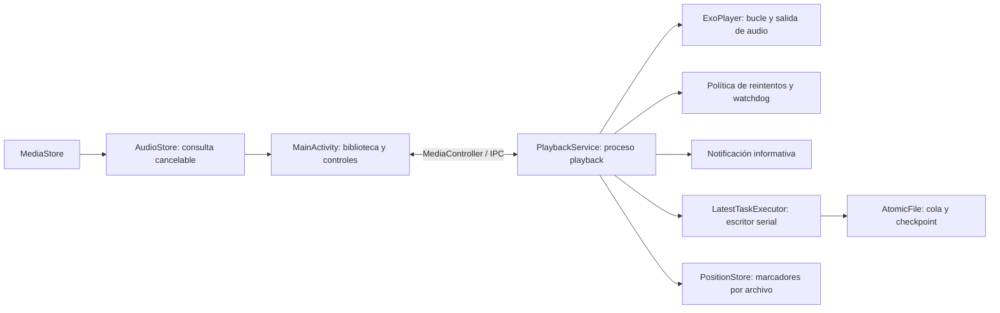

**Análisis técnico de Reproductor Ultimate — 22 de septiembre de 2026**

Nota de publicación: este informe conserva sus conclusiones históricas. Las referencias de líneas corresponden a la versión revisada; los enlaces al código abren los archivos actuales.

Revisión del código local de la versión 1.5, código de versión 6, sobre el commit `831eece`. El árbol de trabajo estaba limpio al comenzar. Esta revisión no modifica la implementación de la aplicación.

El proyecto tiene una base sólida para su objetivo específico: repetir un archivo local durante períodos prolongados, conservar la posición y recuperarse de fallos. El motor y la persistencia están considerablemente más desarrollados que la interfaz. No identifiqué un defecto crítico confirmado en el recorrido principal de reproducción. Hay dos defectos de restauración que conviene corregir y varios límites de experiencia, escalabilidad y validación. Aprobar las pruebas actuales no acredita sonido físico ininterrumpido durante 24 horas.

**Alcance y evidencia.** Se revisaron los 10 archivos Kotlin de producción, manifiesto, recursos, configuración de compilación, 4 clases de pruebas unitarias y 3 de instrumentación. Son 2.290 líneas Kotlin de producción y 1.403 de pruebas, sin contar recursos ni documentación. Hubo revisiones independientes del motor, persistencia e interfaz, contrastadas con el código. Los informes anteriores se trataron como antecedentes: varias de sus incidencias ya están corregidas.

La compilación, Lint y las pruebas unitarias se ejecutaron otra vez con `--rerun-tasks`; no se aceptaron únicamente los resultados de septiembre 19. Entorno: macOS ARM64, JBR 21.0.11, Gradle 8.11.1 y Android SDK local. El código apunta a bytecode Java 17. La versión de Android mínima es API 26; `compileSdk` y `targetSdk` son 35. Kotlin es 2.0.21, AGP 8.7.3 y Media3 1.6.1.

| Comprobación | Resultado de esta revisión |
| --- | --- |
| `assembleDebug` | Correcto |
| `testDebugUnitTest` | 43 pruebas, 0 fallos, 0 errores, 0 omitidas |
| `lintDebug` | 0 errores, 25 advertencias |
| `connectedDebugAndroidTest` | 20 pruebas, 0 fallos, 0 errores, 0 omitidas; Android 17 / API 37 |
| Sonido, batería y temperatura durante 24 horas en hardware | No realizados |

Comandos utilizados:

```sh
ANDROID_HOME=/Users/gustavo/Library/Android/sdk ./gradlew assembleDebug lintDebug testDebugUnitTest --rerun-tasks --console=plain
ANDROID_SERIAL=emulator-5580 ANDROID_HOME=/Users/gustavo/Library/Android/sdk ./gradlew connectedDebugAndroidTest --console=plain
```

El emulador se abrió sin ventana ni sonido, con `-read-only -no-snapshot`, para no conservar sus cambios. Se seleccionó explícitamente su serial; las pruebas no se dirigieron al dispositivo físico conectado. La suite completa aprobó 63 pruebas. Después se repitió una prueba existente de forma aislada para inspeccionar el estado que deja su limpieza; no es un caso nuevo dentro de esas 63 pruebas.

Los registros, XML de resultados, resumen y evidencia del caso de cola vacía se conservan en app/build/reports/audit-2026-09-22 (`app/build/reports/audit-2026-09-22`, referencia local histórica). Esa carpeta está ignorada por Git. El APK debug de esta revisión pesa aproximadamente 8,8 MiB y su SHA-256 es `b322df66044b834299c0c24be7168989fe2f6a49d4135d821de83dea6a3ad2d7`.

**Arquitectura y responsabilidades.** Es una aplicación pequeña de un único módulo, con Views/XML y ViewBinding. No tiene servidor, cuentas, sincronización ni permiso de Internet. La separación importante está entre procesos: la interfaz usa `MediaController`; el servicio posee ExoPlayer y todo el estado de reproducción. Es una elección razonable para que un fallo de la pantalla no termine directamente el motor. No aísla el audio frente a detención de toda la app, reinicio del dispositivo o decisiones del sistema.



`MainActivity` tiene 699 líneas y reúne permisos, biblioteca, conexión, presentación y adaptador. `PlaybackService` tiene 691 y concentra sesión, intención de reproducción, foreground, recuperación y guardado. El tamaño no es por sí mismo un fallo, pero futuros cambios en estos archivos requieren entender varias máquinas de estados a la vez. Conviene extraer responsabilidades cuando se añadan funciones, conservando el confinamiento al hilo principal del reproductor; una reescritura completa no está justificada por los hallazgos actuales.

**Lo que está bien resuelto.**

- La consulta a MediaStore y la creación de `MediaItem` ocurren fuera de la interfaz. Hay cancelación real, comprobación de generación para descartar resultados antiguos y observación de cambios con espera de 500 ms para agrupar eventos.
- La interfaz libera el controlador según su ciclo de vida, intenta reconectarlo y bloquea las acciones hasta que el servicio termina de restaurar. La duración guardada permite mostrar la posición sin arrancar el audio.
- El servicio diferencia intención del usuario, estado de ExoPlayer y recuperación pendiente. Reintenta con esperas de 1, 2 y 5 segundos; cambia de archivo cuando corresponde y espera 30 segundos cuando falla toda la ronda.
- El watchdog exige avance real, no únicamente `isPlaying`. Considera bucles cortos y evita que alternar entre cargando y preparado oculte un atasco.
- Los reintentos quedan invalidados por época y generación. Pausa, detención y navegación explícitas prevalecen sobre recuperaciones antiguas. El wrapper de `stop()` preserva el orden detener → preparar → reproducir.
- Cola y checkpoint se guardan por separado. `AtomicFile`, la generación y un token por ventana evitan mezclar posiciones con colas diferentes. Si falta el checkpoint más reciente, la cola tiene un punto anterior que se restaura pausado.
- El escritor conserva solo el último trabajo pendiente y comparte executor entre instancias consecutivas del servicio. La ventana persistida incluye la pista activa aun cuando la biblioteca supera 20.000 entradas o 16 MiB.
- El servicio no está exportado, valida UID y paquete del controlador, y usa un `PendingIntent` inmutable. Los marcadores ligados a IDs locales se excluyen del backup y transferencia; la cola está en `noBackupFilesDir`.

**Hallazgos priorizados.** P2 indica un defecto funcional que merece corrección; P3, una mejora de menor impacto o una limitación que depende del alcance elegido. La prioridad no implica que todo escenario se haya reproducido en dispositivo.

**1. P2 — Vaciar la cola no vacía su estado persistido. Reproducido en emulador.**

En [PlaybackService.kt:451](app/src/main/java/com/reproductor/audiolibros/PlaybackService.kt), `saveCheckpoint()` retorna cuando `mediaItemCount == 0`. [PlaybackStateStore.kt:157](app/src/main/java/com/reproductor/audiolibros/PlaybackStateStore.kt) tampoco puede escribir una cola vacía y no tiene una operación para invalidar el snapshot.

Secuencia: guardar la pista A → ejecutar `clearMediaItems()` desde un controlador autorizado → recrear el servicio → restaurar A desde disco. Los archivos anteriores no se borran ni se reemplazan. **La interfaz actual no ofrece vaciar cola**, por lo que el alcance inmediato es el contrato del servicio y la limpieza de las pruebas. El teardown instrumentado usa precisamente `pause(); clearMediaItems()` y deja la cola de prueba en el almacenamiento persistente.

Se reprodujo sin cambiar código: se ejecutó aisladamente `prepareAfterStopDoesNotResumeWithoutExplicitPlay`, cuya limpieza vacía la cola; a continuación, `playback_queue.json` aún contenía `continuity-test-320kbps`. Tras detener el proceso y abrir normalmente, la pantalla volvió a mostrar «Continuidad 320 kbps», en pausa. La captura (`app/build/reports/audit-2026-09-22/after-clear-reopen.png`, referencia local histórica), el XML de pantalla (`app/build/reports/audit-2026-09-22/after-clear-reopen.xml`, referencia local histórica) y los JSON anteriores a la reapertura están en la carpeta de evidencia. La prueba adicional aprobó porque no comprueba persistencia después de su teardown.

Corrección: persistir un estado vacío o una invalidación explícita por el mismo escritor serial, de forma que prevalezca sobre las escrituras pendientes. Borrar los archivos en paralelo desde la interfaz introduciría una carrera. Añadir una regresión que guarde A, vacíe, recree y compruebe que no reaparece ninguna pista.

**2. P2 — La biblioteca puede perder su desplazamiento al recrear la pantalla.**

[MainActivity.kt:147](app/src/main/java/com/reproductor/audiolibros/MainActivity.kt) instala un adaptador inicialmente vacío. Los elementos llegan después de la consulta asíncrona, en [MainActivity.kt:381](app/src/main/java/com/reproductor/audiolibros/MainActivity.kt). No se cambia la política predeterminada de restauración del adaptador.

Si el primer layout ocurre antes de terminar la consulta, RecyclerView puede consumir la posición guardada cuando aún no hay elementos. El usuario que estaba lejos del inicio vuelve al principio al girar la pantalla o recrear la Activity. Es un hallazgo estático de confianza alta, condicionado al orden de la carga; no se afirma una reproducción dinámica en esta revisión. La [documentación de RecyclerView.Adapter](https://developer.android.com/reference/androidx/recyclerview/widget/RecyclerView.Adapter#setStateRestorationPolicy(androidx.recyclerview.widget.RecyclerView.Adapter.StateRestorationPolicy)) contempla este problema con carga asíncrona.

Corrección acotada: `adapter.stateRestorationPolicy = RecyclerView.Adapter.StateRestorationPolicy.PREVENT_WHEN_EMPTY`. Verificar una recreación con una biblioteca extensa y la consulta demorada. Esto afecta al desplazamiento de la lista, no a la posición de escucha.

**3. P3 — Las notificaciones no tienen recuperación de permiso independiente.**

[MainActivity.kt:131](app/src/main/java/com/reproductor/audiolibros/MainActivity.kt) responde al resultado de permisos verificando únicamente el de audio. La solicitud inicial incluye `POST_NOTIFICATIONS`, pero permitir audio y rechazar notificaciones deja la biblioteca operativa sin un acceso propio para habilitar estas últimas. Al volver a abrir, `hasAudioPermission()` evita recorrer de nuevo ese flujo.

La notificación es deliberadamente `CATEGORY_SERVICE` y no usa `MediaStyle`: [PlaybackNotificationProvider.kt:44](app/src/main/java/com/reproductor/audiolibros/PlaybackNotificationProvider.kt). No debe darse por supuesta la exención reservada a notificaciones multimedia. El servicio puede funcionar aunque el aviso no aparezca en el panel; Android distingue ambos comportamientos en su [documentación de permisos de notificación](https://developer.android.com/develop/ui/compose/notifications/notification-permission).

Impacto: se pierde el acceso desde la notificación a la pantalla donde está la pausa. La app sigue siendo accesible desde su icono. Ofrecer un estado y un acceso opcional a ajustes de notificaciones, respetando la negativa sin repetir solicitudes automáticamente. El flujo incompleto está demostrado por código; no se ha medido aquí la presentación en todos los fabricantes.

**4. P3 — “Todos los audios” es más amplio que la consulta implementada.**

[AudioStore.kt:97](app/src/main/java/com/reproductor/audiolibros/AudioStore.kt) exige `DURATION > 0`. Cualquier fila cuya duración sea cero o desconocida queda fuera. Además, solo se ve lo indexado y accesible mediante MediaStore: no existe exploración por carpeta o Storage Access Framework.

La exclusión es verificable; no se encontró en esta revisión un archivo concreto reproducible que MediaStore reportara así. Decidir si se desea admitir metadatos incompletos y descubrir duración al preparar, o documentar expresamente el filtro. No añadir búsquedas de duración sincrónicas a toda la biblioteca.

**5. P3 — La selección en la lista se comunica solo mediante color.**

[MainActivity.kt:671](app/src/main/java/com/reproductor/audiolibros/MainActivity.kt) colorea el título actual, sin establecer un estado seleccionado o descripción de estado para esa fila. La barra inferior sí informa del título, pero la lista no transmite por sí misma la selección a un lector de pantalla. Añadir una señal visual y semántica; verificar con TalkBack. La barra de avance y el botón de reproducción ya tienen etiquetas y contemplan controles distintos al gesto táctil.

**Continuidad y calidad del sonido.** El diseño aumenta la tolerancia a fallos, pero distingue tres cosas: conservar el archivo, decodificar correctamente y producir sonido continuo en la salida física. Las pruebas cubren partes diferentes de esa cadena.

La app no implementa recodificación, normalización ni efectos; fija velocidad, tono y ganancia digital en 1, y desactiva el salto de silencios. El buffer de 60–120 segundos reduce la dependencia inmediata del almacenamiento, con umbral adicional de memoria. La cuenta de 120 segundos a 320 kbps equivale aproximadamente a 4,8 MB de audio comprimido, no al consumo total del proceso.

El test del MP3 verifica formato declarado, bitrate aproximado, frecuencia, canales, parámetros y hash del archivo. Eso acredita que el archivo no se modifica; no mide fidelidad acústica. El test de PCM flotante comprueba recorte del delay/padding y bytes aceptados por AudioTrack usando muestras sintéticas. No demuestra que todos los formatos, decodificadores y rutas reales usen salida flotante o sean bit-perfect. El indicador de bitrate describe el archivo, no el códec Bluetooth ni la señal del altavoz.

La ausencia de foco automático, la continuidad tras desconectar auriculares, el bucle obligatorio y el bloqueo de controles externos son decisiones expresas del README. Cambiarlas requeriría una decisión de producto. Sus consecuencias sí importan: el sonido puede pasar al altavoz y la pausa depende de entrar en la aplicación. El watchdog observa posición y transiciones; no escucha el altavoz ni detecta todo silencio físico.

**Persistencia, rendimiento y límites medibles.** El checkpoint se intenta guardar cada dos segundos durante la reproducción: unas 43.200 oportunidades de escritura por día, antes de deduplicación y eventos adicionales. Debe medirse el consumo real de CPU, disco y batería. La agrupación de marcadores a 30 segundos ayuda, pero no sustituye esa medición.

En [PositionStore.kt:19](app/src/main/java/com/reproductor/audiolibros/PositionStore.kt), `force = true` termina en `SharedPreferences.apply()`: fuerza la solicitud de escritura, no una confirmación síncrona de disco. Una muerte abrupta puede dejar atrás un marcador reciente; el checkpoint separado protege mejor la pista activa. No es correcto prometer que siempre se perderán como máximo dos segundos, porque la cola de escritura, el almacenamiento y el momento de muerte también intervienen.

La caché de posiciones y las claves `pos_*` no tienen poda. La biblioteca completa existe como `AudioItem`, `MediaItem`, timeline y, al guardar, JSON. Los 16 MiB acotan el archivo persistido, no el pico de memoria ni la cola en reproducción. Cada cambio a otra pista envía nuevamente toda la biblioteca; `notifyDataSetChanged()` invalida todas las filas visibles. Son oportunidades para medir con 1.000, 10.000 y 20.000 entradas antes de introducir paginación o una base de datos. No se demostró un ANR, un OOM ni un error de tamaño de Binder.

Como caso marginal de la utilidad `LatestTaskExecutor`, una entrega concurrente puede perderse si coincide con el rechazo del despacho por el executor delegado: el `catch` borra también el `pending` posterior. El executor actual es estático, no se cierra y sus productores normales están en el hilo principal; por ello no es una prioridad del funcionamiento actual. Debe aclararse ese contrato si se reutiliza la clase con ejecutores que puedan rechazar trabajo.

**Seguridad y publicación.** La superficie expuesta es reducida: no hay red propia, WebView, servidor ni sesión exportada. No encontré exfiltración o un acceso externo evidente a los controles. La notificación usa `VISIBILITY_PUBLIC` y muestra el título en pantalla bloqueada; conviene ofrecer una opción de privacidad si los títulos son sensibles. Esto es una decisión de presentación, no una vulnerabilidad confirmada.

Las 25 advertencias de Lint se distribuyen así: 7 de dependencias, 8 recursos sin uso, 3 invalidaciones completas del adaptador y 7 de otros tipos. La de API 29 sobre `FOREGROUND_SERVICE_TYPE_MEDIA_PLAYBACK` no demuestra un crash en API 26: se pasa una constante a `ServiceCompat`, que contempla versiones antiguas en su [contrato de compatibilidad](https://developer.android.com/reference/androidx/core/app/ServiceCompat#startForeground(android.app.Service,int,android.app.Notification,int)). La advertencia sobre exención de batería requiere revisar la justificación del caso de uso; no permite concluir automáticamente un rechazo de publicación. Android documenta los casos y limitaciones en su [guía de Doze](https://developer.android.com/training/monitoring-device-state/doze-standby).

No hay CI versionada, archivo de licencia ni configuración de firma release en el repositorio. La minificación de release está desactivada y el archivo ProGuard no añade reglas. Esto no impide usar la app localmente; una distribución mantenida necesita definir firma y custodia de claves, construir y verificar release, automatizar controles y aclarar la licencia de distribución. Las advertencias de versiones son una tarea de mantenimiento, no prueba de vulnerabilidades. No se realizó una auditoría de CVE ni se propone actualizar todo simultáneamente sin regresiones.

**Qué demuestran las pruebas y qué falta.**

| Área | Cobertura versionada | Hueco principal |
| --- | --- | --- |
| Reintentos | 9 pruebas unitarias de esperas, rondas e índices | Integración con fallos reales intermitentes |
| Watchdog | 19 pruebas unitarias, incluidos bucles y 24 h virtuales | Atasco del reproductor real y reconstrucción posterior |
| Escritor | 9 pruebas unitarias de concurrencia y fallos | Rechazo concurrente; fallos reales de almacenamiento |
| Marcadores | 6 pruebas unitarias | Muerte del proceso durante `apply()` |
| Persistencia Android | 8 pruebas instrumentadas | Vacío, muerte del proceso y fases reales de escritura interrumpida |
| Servicio | 11 pruebas instrumentadas | Reinicio sticky, reconstrucción con controlador conectado y límites de foreground |
| PCM flotante | 1 prueba instrumentada | Formatos y salidas físicas distintas |
| Interfaz | Sin suite dedicada | Permisos, restauración de scroll, TalkBack, rotación y ventanas pequeñas |

La prueba de pausa durante archivos inaccesibles espera tres segundos, aunque existe un reintento a 30 segundos. Comprueba la pausa inicial, pero no observa toda la ventana que pretende cancelar. Conviene cubrir además pausa/seek coincidiendo con un callback y que un controlador externo sea rechazado. Los documentos anteriores registran ensayos de Doze y reinicio de procesos; no todos esos ensayos forman parte de una suite versionada reproducible.

Antes de sostener una garantía de uso prolongado, realizar una sesión física de 24 horas en el dispositivo de destino, registrando interrupciones reales, posición, memoria, batería, temperatura y cambios de ruta de audio. Separar una parada solicitada por el usuario de una interrupción recuperable. Probar varias versiones de Android dentro del rango admitido: ejecutar solo en API 37 no cubre desde API 26.

**Orden recomendado de trabajo.**

1. Corregir el estado vacío persistido y añadir la regresión vaciar → recrear; corregir también el aislamiento de las pruebas del servicio.
2. Ajustar la política de restauración de RecyclerView y comprobar una carga lenta; añadir estado independiente de notificaciones y selección accesible.
3. Incorporar pruebas de reinicio del proceso, restauración pausada, recuperación con reconstrucción del motor y cancelación durante toda la espera de 30 segundos.
4. Medir bibliotecas grandes y reproducción prolongada en hardware; optimizar únicamente los costes observados.
5. Automatizar build/Lint/tests, verificar release y actualizar dependencias por grupos con regresiones. Mantener los análisis anteriores claramente identificados como históricos.

El trabajo más valioso es cerrar estos casos concretos y ampliar la evidencia de funcionamiento. La estructura actual permite hacerlo de forma incremental sin sustituir el motor ni rediseñar toda la aplicación.
