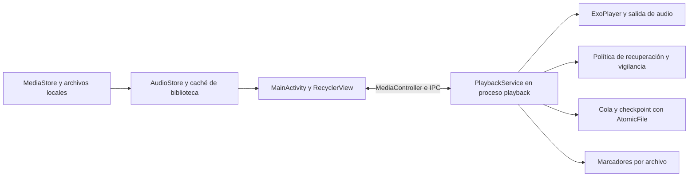

# Análisis técnico del reproductor de audiolibros

Nota de publicación: este informe conserva sus conclusiones históricas. Las referencias de líneas corresponden a la versión revisada; los enlaces al código abren los archivos actuales.

Fecha: 27 de octubre de 2026, America/Lima. Versión examinada: 2.0.1, código 11.

La aplicación tiene una base sólida para su objetivo específico: reproducir un audio local en bucle, conservar el progreso y recuperarse de determinados fallos con controles dentro de la app. La separación del proceso de audio, las escrituras atómicas, la cancelación de reintentos antiguos y las pruebas de lógica son sus puntos más fuertes. La prioridad siguiente debería ser comprobar la continuidad en el teléfono real y reforzar la evidencia de persistencia, antes de añadir más mecanismos de recuperación.

No se identificó un defecto crítico de reproducción confirmado en esta revisión. Sí se identificaron una debilidad verificable del ensayo corto de continuidad y estados de interfaz que pueden descartar toques o conservar información antigua mientras se reconecta. Los riesgos de pérdida de marcadores, identidad de archivos y latencia con bibliotecas grandes se describen como escenarios condicionados, no como fallos reproducidos.

El análisis combinó tres subagentes GPT-6.1 Terra —motor, persistencia e interfaz— con revisión y validación del coordinador. Se examinaron 18 archivos Kotlin de producción, con 3.167 líneas; 10 archivos de pruebas unitarias, con 86 casos; y 10 archivos Android de pruebas y auxiliares, con 64 anotaciones `@Test`. Estas cifras describen el alcance del código, no un porcentaje de cobertura. No se modificaron fuentes de la aplicación.

## Validación realizada

| Comprobación | Resultado actual | Alcance |
| --- | --- | --- |
| Ensamblado debug | Correcto | Gradle validó el APK; pudo reutilizar salidas vigentes |
| Ensamblado benchmark | Correcto | R8 y reducción de recursos activos |
| Pruebas unitarias | 86 aprobadas, 0 fallos, 0 errores, 0 omitidas | Se forzó una ejecución nueva, sin caché de compilación |
| Lint debug | 0 errores y 21 advertencias | No equivale a ausencia de errores de ejecución |
| APK de pruebas debug | Compila | No ejecutado en Android durante esta revisión |
| APK de validación benchmark | Compila | Su manifiesto binario apunta al paquete correcto |
| Firma de benchmark y validación | Verificada; mismo certificado local | Firma de desarrollo, no configuración de distribución |
| Pruebas instrumentadas y escucha de 24 horas | Pendientes | ADB no detecta dispositivos; no hay AVD configurado ni ejecutable de emulador en el SDK comprobado |

El entorno de compilación utiliza JBR 21.0.11, Gradle 8.11.1, AGP 8.7.3 y Kotlin 2.0.21. El proyecto configura Java/Kotlin con destino JVM 17, `minSdk=26`, `compileSdk=35` y `targetSdk=35`. Compilar aquí no demuestra una ejecución en todas esas versiones de Android.

El APK benchmark generado ocupa 2.936.427 bytes. Los tamaños, hashes SHA-256, manifiestos, verificación de firmas, XML de pruebas y logs de esta ejecución quedan en [la carpeta de evidencia (archivo de evidencias)](https://github.com/gustavoamarohidalgo1-ctrl/Reproductor_28_Octubre/releases/download/v2.1.0/Evidencias-2.1.0.zip). Los informes anteriores de septiembre contienen resultados históricos; no se han contado como nuevas ejecuciones.

Comandos de validación, con `ANDROID_HOME` configurado:

```bash
./gradlew :app:assembleDebug :app:testDebugUnitTest :app:lintDebug \
  :app:assembleBenchmark :app:assembleDebugAndroidTest :validation:assembleBenchmark --console=plain
./gradlew :app:testDebugUnitTest --rerun-tasks --no-build-cache --console=plain
```

## Arquitectura y comportamiento



La interfaz descubre archivos mediante MediaStore, prepara una biblioteca inmutable y se conecta al servicio por Media3. El servicio es propietario del reproductor y del estado persistido. Al seleccionar otra pista de una cola compatible, la interfaz envía un cambio de índice y el servicio recupera su marcador; cuando cambia la biblioteca, envía una cola nueva. Las lecturas y escrituras de la sesión comparten un executor de disco.

El proceso separado permite que el audio sobreviva a determinados fallos de la interfaz. No elimina las restricciones de Android, los fallos del proceso de audio ni las interrupciones físicas de la salida. La apertura normal restaura en pausa; una recuperación `START_STICKY` puede reanudar dentro del mismo arranque si la intención guardada lo permite. El código comprueba también cierres solicitados por el usuario en versiones compatibles.

El producto impone repetición de la pista elegida, velocidad y tono de 1, ganancia digital de 1 y salto de silencios desactivado. Bloquear controles externos y no pausar al desconectar auriculares son decisiones explícitas del README. Si un archivo resulta inaccesible, la recuperación puede pasar a otro archivo. Son comportamientos que conviene mantener claramente explicados en la interfaz y en las instrucciones de uso.

## Aspectos bien resueltos

- **Aislamiento y control de sesión.** El servicio no está exportado y acepta controladores con UID y paquete propios. La notificación carece de acciones de reproducción. Véanse [el manifiesto](app/src/main/AndroidManifest.xml) y [la autorización](app/src/main/java/com/reproductor/audiolibros/PlaybackService.kt).
- **Recuperación acotada.** Los reintentos transitorios esperan 1, 2 y 5 segundos; después pueden cambiar de pista y, si todas fallan, esperar 30 segundos. La generación de cola y el identificador del intento invalidan recuperaciones antiguas. Una pausa o selección explícita tiene precedencia. Véanse [la política](app/src/main/java/com/reproductor/audiolibros/PlaybackRecoveryPolicy.kt) y [su ejecución](app/src/main/java/com/reproductor/audiolibros/PlaybackService.kt).
- **Persistencia de sesión defensiva.** Cola y checkpoint se relacionan mediante generación y token. Un registro atómico de cola vacía evita recuperar una cola anterior. Si falta el checkpoint reciente, el inicial permite restaurar en pausa. La lectura limita bytes, entradas y profundidad del JSON. Véase [PlaybackStateStore](app/src/main/java/com/reproductor/audiolibros/PlaybackStateStore.kt).
- **Control de trabajo pendiente.** El escritor mantiene una tarea activa y la última pendiente. Los snapshots incluyen la cola de la que dependen; descartar estados intermedios no rompe esa dependencia. El backoff reduce reintentos sobre almacenamiento que falla. Véase [LatestTaskExecutor](app/src/main/java/com/reproductor/audiolibros/LatestTaskExecutor.kt).
- **Biblioteca y UI cuidadas.** Hay cancelación de consultas, tickets contra publicaciones antiguas, validación por versión/generación de MediaStore, diff acotado y búsqueda de tamaño solo para la pista activa. La barra admite duraciones superiores al rango de un entero de milisegundos. Estas medidas evitan trabajo repetido, aunque no sustituyen mediciones de latencia en un teléfono.
- **Pruebas de casos difíciles.** Las fuentes incluyen interrupciones reales del proceso de servicio, cola vacía, archivos ilegibles, pausas durante recuperación, colas de gran tamaño, fallos de guardado y posiciones posteriores a 24 horas. Su existencia y compilación están verificadas; su ejecución Android actual sigue pendiente.

## Hallazgos y riesgos priorizados

**1. P2 en validación: un ensayo corto puede aprobar sin checkpoint válido. Confianza alta por inspección del código.**

`lastCheckpointProgressAt` comienza con el instante de inicio. La condición exige únicamente que no transcurran 60 segundos desde ese valor o desde un cambio de timestamp. Por tanto, una ejecución de 10 o 30 segundos puede terminar como `passed` aunque nunca consiga leer el archivo de checkpoint. Además, el primer timestamp antiguo no nulo se acepta como observación sin comprobar que pertenezca a la sesión ensayada. Esto debilita la conclusión sobre persistencia del ensayo corto; no demuestra que el guardado de producción esté fallando. Véanse [la inicialización](app/src/androidTest/java/com/reproductor/audiolibros/LongPlaybackSoakInstrumentedTest.kt) y [la condición de frescura](app/src/androidTest/java/com/reproductor/audiolibros/LongPlaybackSoakInstrumentedTest.kt).

La corrección debería exigir al menos un checkpoint verificablemente nuevo de la sesión actual antes de aprobar, y comprobar posteriores actualizaciones según la duración solicitada. La prueba negativa debería bloquear o retirar el guardado y demostrar que un ensayo corto falla. No basta con aumentar la duración mínima.

**2. P3 de interfaz: selección silenciosamente descartada durante restauración. Confianza alta sobre el flujo; frecuencia e impacto no medidos.**

La lista puede mostrarse desde la caché antes de que el servicio publique `STATE_RESTORED`. Las filas siguen teniendo un listener de toque, pero `playAudio()` retorna inmediatamente. Una persona puede tocar una pista, no recibir respuesta y terminar viendo la pista anterior restaurada en pausa. Al perder la conexión también se deshabilitan los controles, mientras título, calidad y tiempos pueden conservar sus valores antiguos porque las actualizaciones retornan temprano. Véanse [selección](app/src/main/java/com/reproductor/audiolibros/MainActivity.kt), [desconexión](app/src/main/java/com/reproductor/audiolibros/MainActivity.kt) y [actualización visual](app/src/main/java/com/reproductor/audiolibros/MainActivity.kt).

Conviene modelar estados explícitos de conexión, restauración y disponibilidad, y decidir si se deshabilitan las filas o se conserva la última selección pendiente. El tiempo guardado puede seguir visible, pero debe distinguirse de una reproducción conectada. Falta una prueba con restauración deliberadamente lenta y otra de desconexión prolongada.

**3. Riesgo condicionado de durabilidad: los marcadores no tienen la misma confirmación que el checkpoint.**

`PositionStore` escribe con `SharedPreferences.apply()`, y la caché actualiza inmediatamente su campo `persisted`. Android documenta que `apply()` actualiza memoria y escribe al disco de forma asíncrona sin notificar fallos. Véanse [PositionStore](app/src/main/java/com/reproductor/audiolibros/PositionStore.kt), [la caché](app/src/main/java/com/reproductor/audiolibros/PositionCheckpointCache.kt) y [el contrato oficial de apply](https://developer.android.com/reference/android/content/SharedPreferences.Editor#apply()).

El escenario que merece probarse es pasar de A a B y matar abruptamente el proceso después de persistir la sesión de B, pero antes de que el marcador de A llegue al disco, o durante un fallo de esa escritura. La sesión protege el archivo activo; no asegura todo el historial. Una escritura posterior exitosa puede guardar también cambios pendientes y evitar la pérdida. No se reprodujo una pérdida de este tipo durante esta revisión.

La mejora sería confirmar el guardado fuera del hilo del reproductor y distinguir estado enviado de estado confirmado. Sustituir `apply()` por `commit()` directamente en el hilo principal introduciría otro problema. Además, el límite de 256 entradas corresponde a la caché, no al archivo de preferencias: los marcadores antiguos no tienen una política de limpieza activa.

**4. Límite deliberado: una cola grande se restaura parcialmente.**

La persistencia conserva hasta 20.000 entradas y 16 MiB, priorizando la pista activa. El reproductor en ejecución mantiene la cola completa, pero tras morir el proceso solo puede recuperar lo guardado. Es una protección de recursos documentada, no corrupción accidental. Véanse [la selección de ventana](app/src/main/java/com/reproductor/audiolibros/PlaybackStateStore.kt) y [los límites](app/src/main/java/com/reproductor/audiolibros/PlaybackStateStore.kt).

No conviene restaurar sin más la revisión original de la biblioteca para optimizar el cambio de pista: podría corresponder a una cola completa cuyos índices ya no coinciden con la ventana recuperada. Si se necesita restauración completa, debe reconciliarse explícitamente con MediaStore y probar la identidad e índices resultantes.

**5. Riesgos de escala e identidad que requieren medición o reproducción.**

La captura de cola y la reconstrucción del reproductor copian todos los `MediaItem` en el hilo del servicio. La primera transferencia de biblioteca también transporta la lista completa. Son costes lineales; no hay una medición actual que permita afirmar un ANR, un umbral de memoria o un fallo de Binder. Véanse [captura](app/src/main/java/com/reproductor/audiolibros/PlaybackService.kt) y [reconstrucción](app/src/main/java/com/reproductor/audiolibros/PlaybackService.kt).

La identidad persistida usa el ID numérico de MediaStore y su URI. La caché sí comprueba la versión del proveedor, pero los marcadores no incluyen esa versión. Si una reconstrucción o sustitución del catálogo reasignara un ID a otro archivo, podría aplicarse un marcador antiguo. La reasignación concreta no se reprodujo: debería comprobarse con reconstrucción del proveedor y medios extraíbles antes de diseñar una migración de identidad.

## Continuidad y calidad de audio

El buffer solicitado es de 60 a 120 segundos, con reserva hacia atrás de 10 segundos y umbrales de inicio de 2,5 y 5 segundos. A 320 kbps, 120 segundos equivalen a unos 4,8 MB de datos comprimidos. Esa cuenta no mide la RAM total: también existen colas, objetos, decodificadores, muestras de salida y otros buffers, y el umbral de bytes del motor puede limitar lo que se precarga. Los archivos PCM o de alta resolución requieren un análisis distinto.

El vigilante busca falta de avance durante 20 segundos. Recuperarse después de ese plazo puede ser correcto para disponibilidad, pero ya implica una interrupción perceptible si el problema afectó al sonido. Una posición que avanza tampoco demuestra que el altavoz produzca audio. Las pruebas instrumentadas existentes de formato, checksum y recorte gapless, cuya ejecución actual está pendiente, no certifican toda la cadena de salida.

La configuración no añade recodificación del archivo, cambios de velocidad ni normalización. `setEnableAudioFloatOutput(true)` solicita salida flotante cuando la ruta lo permite; no garantiza salida bit-perfect, ni transforma un archivo con pérdida en alta resolución. El propio contrato de [Media3](https://developer.android.com/reference/androidx/media3/exoplayer/DefaultRenderersFactory#setEnableAudioFloatOutput(boolean)) condiciona la salida float a su disponibilidad. El indicador de bitrate describe el archivo y no el códec Bluetooth ni la señal física del dispositivo.

## Mantenibilidad y entrega

`MainActivity` contiene 918 líneas y `PlaybackService` 792: juntas concentran alrededor del 54 % del Kotlin de producción. El tamaño no prueba un defecto, pero refleja responsabilidades mezcladas. En la actividad conviven permisos, catálogo, conexión, selección, metadatos y vistas. En el servicio conviven autorización, ciclo de vida, recuperación, persistencia y notificación. Extraer estado de UI, acceso al catálogo y coordinación del guardado por pasos pequeños facilitaría pruebas sin reescribir el motor.

De las 21 advertencias de lint, siete corresponden a versiones de dependencias y ocho a recursos sin uso. Las restantes abarcan batería, constante de API, exhaustividad de eventos, carpeta de recursos, dibujo y icono monocromático. La constante del tipo de servicio pasa por `ServiceCompat`; el aviso no demuestra por sí mismo un fallo en Android 26–28. Las actualizaciones de Media3, AGP o Kotlin deberían hacerse con las pruebas de bucle, float, restauración y APK optimizado, no solo para eliminar avisos.

La solicitud directa de excepción de batería merece revisión si se distribuye en Google Play. [Android](https://developer.android.com/training/monitoring-device-state/doze-standby#support_for_other_use_cases) limita esa solicitud a casos aceptables donde la función principal queda afectada. La advertencia de lint no determina por sí sola el resultado de una revisión de publicación.

La variante benchmark usa la clave debug local; `release` no define una firma de distribución. El arnés optimizado modifica un manifiesto generado mediante una API de tareas de AGP y una propiedad experimental. Ahora compila y su APK apunta correctamente a `com.reproductor.audiolibros`, con el mismo certificado que benchmark; su funcionamiento instrumentado deberá comprobarse en dispositivo en esta versión y repetirse al actualizar AGP.

Esta carpeta no contiene `.git` ni configuración de CI visible. No permite auditar historial, ramas o automatización del repositorio remoto. El wrapper fija Gradle pero carece de `distributionSha256Sum`; tampoco se observan archivos de locking o verificación de dependencias. Añadir verificación de descargas y una ejecución automatizada de las comprobaciones actuales mejoraría la trazabilidad de entregas.

El manifiesto compilado no solicita `INTERNET`; el código propio revisado no incorpora un backend ni analítica. El servicio es privado y los estados locales se excluyen del backup pertinente. Esto reduce superficie de exposición, sin constituir una auditoría completa de seguridad de todas las dependencias.

## Plan de validación y mejora

| Orden | Trabajo | Criterio para darlo por terminado |
| --- | --- | --- |
| 1 | Endurecer el ensayo corto | Sin checkpoint nuevo y correspondiente a la sesión, la prueba debe fallar; con guardado sano, debe pasar |
| 2 | Explicitar los estados de UI | Un toque durante restauración recibe respuesta clara o queda pendiente; una desconexión no presenta datos antiguos como estado conectado |
| 3 | Ejecutar suites Android debug y benchmark | Resultados nuevos en un dispositivo de pruebas, incluidos persistencia, reinicio, formato y bucle; comparar ambas variantes |
| 4 | Validar 24 horas reales | Archivo audible, teléfono de destino, pantalla apagada, registro de errores y salida física; medir interrupciones, batería y temperatura |
| 5 | Probar fallos y límites | AudioTrack, promoción a primer plano, almacenamiento lento/lleno, muerte abrupta, permisos y SD; verificar pausa y selección durante recuperación |
| 6 | Medir bibliotecas grandes | Comparar 1.000, 10.000 y más de 20.000 entradas; registrar latencia de selección/restauración, memoria de ambos procesos e I/O |
| 7 | Mejorar estructura y entrega | Refactorizaciones pequeñas con comportamiento conservado; firma estable, verificación de dependencias y comprobaciones automatizadas |

La prueba de 24 horas debe distinguir altavoz, auriculares y Bluetooth; registrar modelo, versión de Android, archivo y condiciones de batería. También debe separar muerte del proceso de una orden explícita de detener o forzar cierre: las expectativas de recuperación son distintas. Las pruebas que sustituyen la cola o provocan fallos de disco deben ejecutarse en un entorno dedicado.

La decisión técnica recomendada es conservar el diseño general, reforzar primero la validación y los estados de interfaz, y después medir los costes reales antes de optimizar o sustituir componentes.
